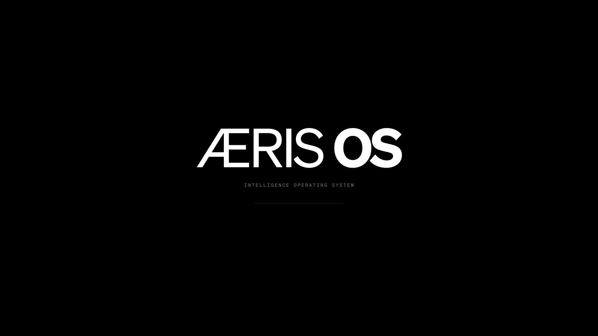

# AerisOS

A monochrome Arch Linux + Hyprland setup: black, charcoal, grey and white,
Söhne type at one size, no colour anywhere it can be avoided.



One script, `setup.sh`, installs the software and applies every
personalisation. A short wizard asks the personal bits (name, email, hostname,
whether you want the maps app); everything else is automatic.

## New machine, from scratch

Start from a **minimal Arch Linux install** (archinstall is fine), log in as
root, and:

```bash
pacman -Sy --noconfirm git
git clone https://github.com/hjbarraza/aerisos.git /root/aerisos
bash /root/aerisos/install.sh
```

The repo is private — HTTPS asks for your GitHub username and a personal access
token ("repo" scope), or clone over SSH. `install.sh` asks for your **username
and password**, creates the account with sudo, moves the repo into your home,
and hands over to `setup.sh`, which runs the wizard and installs everything
(Hyprland included). Then `reboot`.

The **defence-maps app is optional** and lives in its own private repo; say yes
in the wizard (or run `./setup.sh maps` later) and it's cloned to `~/maps`.

### Or: bootable AerisOS USB

Build an installer ISO with the repo baked in (no GitHub access needed on the
new machine):

```bash
sudo ~/aerisos/iso/build.sh                            # → iso/out/aerisos-*.iso
sudo cp iso/out/aerisos-*.iso /dev/sdX && sync         # write to USB (ERASES it)
```

Boot the USB (UEFI), connect Wi-Fi if needed (`iwctl`), and run
**`aeris-installer`**: it asks for the disk (typed `ERASE` to confirm),
timezone, and your **username + password**, installs a minimal Arch with
systemd-boot on btrfs, and puts the repo in your home. After the reboot, log
in and run the one command it leaves in the login message:
`cd ~/aerisos && ./setup.sh`. The ISO carries the repo at the commit it was
built from, so rebuild it now and then.

### T2 Macs (Intel MacBook Pro/Air 2018–2020 etc.)

The stock Arch kernel has no internal keyboard, trackpad or Wi-Fi on these.
The way that works: **build the T2 USB on a T2 Mac that already runs AerisOS**
(this one), so it carries the `linux-t2` kernel and the Apple Wi-Fi firmware:

```bash
sudo ~/aerisos/iso/build.sh --t2                       # → iso/out/aerisos-t2-*.iso
sudo cp iso/out/aerisos-t2-*.iso /dev/sdX && sync      # write to USB (ERASES it)
```

Hold **Option** at power-on and pick the USB (Startup Security Utility must
allow booting from external media). Keyboard and Wi-Fi work on the USB:
`iwctl station wlan0 connect "SSID"`, then **`aeris-installer`**. It sees the T2
chip and installs `linux-t2` (from the arch-mact2 repo, kept in `pacman.conf`),
the firmware, and a boot entry with the T2 kernel options. After the reboot,
`cd ~/aerisos && ./setup.sh` as usual. The firmware is Apple's: keep that ISO to
yourself.

**No T2 Mac running yet?** Stock Arch ISO + a USB keyboard, then:
1. Install with archinstall; before rebooting, `arch-chroot /mnt` and run
   `bash t2/chroot.sh` (repo, kernel, firmware fetcher, default `Arch T2` boot
   entry).
2. First boot, no Wi-Fi: USB-tether a phone and run `bash t2/firmware.sh`
   (firmware from Apple's recovery image; pick Sonoma or any macOS from Monterey on).
3. `install.sh` / `setup.sh` as usual.

`setup.sh`'s `t2` module (skipped on other machines) keeps the arch-mact2 repo
in `pacman.conf`, turns off testing repos and stops NetworkManager fighting the
T2's internal ethernet. The T2 Mac's Radeon 5500M runs the local model through
Vulkan (`ollama-vulkan`, `qwen3.5:4b`; ROCm doesn't support it), and Steam is
skipped there (NVIDIA machines only).

**Known hardware fault — external display flicker (horizontal bands):** this
MacBookPro16,1's Radeon DP output stage is degraded; at 5K bandwidth it produces
transient bit errors — band flicker on every port and display, under macOS too,
with the link never dropping (nothing in any log). Clocks, heat and the DP link
were ruled out (2026-10-22); the picture is clean at lower link rates. The fix is
a bandwidth cap: `hyprland.lua` pins the Studio Display to 4K@60 on this model
(DMI-keyed `hl.monitor` rule; other hosts drive it at native 5K). If another
display flickers the same way on a T2, add a rule like it and step the mode down
until the bands stop. The real repair would be board-level.

## Quick start (already on Arch + Hyprland)

```bash
cd ~/aerisos
./setup.sh --dry-run     # see what would happen, change nothing
./setup.sh               # wizard, then everything
reboot
```

Run it **as your normal user in a real terminal** (ghostty, not Claude's `!` prompt):
it calls `sudo` itself and needs to ask for your password. It's safe to re-run;
every step skips work that's already done, and if a step fails it stops and
tells you which module to re-run. Every run is logged to
`~/.local/state/aerisos/setup-<date>.log`, so a failure can be read afterwards.

Run only some parts by naming modules:

```bash
./setup.sh steam controller      # just gaming
./setup.sh theme                 # re-apply the monochrome look
./setup.sh --list                # all module names
```

## Modules

`./setup.sh` with no arguments runs them in this order. The last three are **optional**: they only run when you name them, e.g. `./setup.sh razer`.

| Module | What it does |
|---|---|
| `t2` | *T2 Macs only, skipped elsewhere.* Keeps the `arch-mact2` repo in `pacman.conf` (so `linux-t2` updates), turns off testing repos, keeps `linux-t2` + the Wi-Fi firmware fetcher installed, and stops NetworkManager trying to bring up the T2's internal ethernet. Runs first. |
| `essentials` | Brave (Flathub, with a `brave` command), `w3m` (a browser in the terminal) and Claude Code, installed before anything else so there's a browser and help even if a later module fails. Never stops the install. |
| `wizard` | Asks the personal questions once — your name and email (git commits), the machine's hostname, whether to install the defence-maps app, and whether to guard login with a **security key** — and saves the answers to `~/.config/aerisos/setup.conf`. Later runs reuse them; change answers with `./setup.sh wizard`. |
| `packages` | Enables the `multilib` repo, updates the system, installs `yay`, then every package in `packages/pacman.txt` and `packages/aur.txt` (without an NVIDIA GPU it leaves out the NVIDIA drivers, CUDA, EnvyControl and Steam). |
| `hardware` | NVIDIA hybrid graphics: open NVIDIA driver, keeps nouveau out of the boot image, suspend/resume services, stable `/dev/dri/intel-igpu` and `/dev/dri/nvidia-dgpu` names, [EnvyControl](https://github.com/bayasdev/envycontrol) for GPU modes (see [GPU modes](#gpu-modes)), and early Intel graphics (`i915` in the boot image, so the boot animation draws from the start and the firmware logo doesn't reappear). Removes the KDE password agent (Hyprland's is used). On a **Razer Blade 17 (2022)** it also fixes the built-in microphone. Everything is generated from the detected hardware, so it's safe on other machines. |
| `steam` | Steam plus 32-bit Vulkan drivers for whatever GPUs it finds. NVIDIA machines only; skipped elsewhere. |
| `controller` | Xbox controllers: USB works out of the box; Bluetooth via `xpadneo`; the Xbox Wireless Adapter dongle via `xone`. Enables Bluetooth and loads `uinput` for Steam Input. |
| `dotfiles` | Copies the saved configs in `dotfiles/home/` into place: shell (`.bashrc`), Hyprland (including two terminals opened at login), Quickshell (the top bar and the pill dock, QML in `~/.config/quickshell/`: a bold Æ mark on the left that opens the AerisOS menu, monochrome throughout; Stay Awake is on by default at login — its coffee-cup icon stays visible dimmed when off, so one click re-arms it; an **AERIS alerts pill** that reads inverted when `status.json` raises an alert, and a **watchlist counter** — the eye icon — showing unacknowledged findings: click opens the watch page and marks it read, middle-click acknowledges without opening, right-click floats the inbox), ghostty (padded, AERIS theme; `performable:ctrl+v` so an image-only clipboard reaches the app, e.g. pasting screenshots into Claude Code), GTK, Voxtype, Vicinae, swayosd, fonts, default apps and the `~/.local/bin` helper scripts (incl. `aeris-watch`, `aeris-inbox`, `aeris-onto`, `watch-open`, `aeris-alerts`, `screen-off`), the autostart override that keeps nm-applet off (the bar's wifi icon + nmtui replace it), the OpenCode config (`~/.config/opencode`: AERIS agent, board plugin, `/watch` `/inbox` commands — without `node_modules`), the Claude Code skills (`~/.claude/skills`) and `~/AGENTS.md`, the watchlist data, and the `aeris-watch`/`defence-maps` user units. Anything it overwrites is backed up first to `~/.local/state/aerisos/backup-<date>/`. |
| `login` | SDDM login screen with the **aeris** theme (`sddm/aeris/`), on the same layout as the lock screen: wordmark, tagline and rule top left with the **WATCHLIST** and **WORLD** feeds under them (telegram-compressed one-liners, `★` = unacknowledged), the login (user | password) at the top of the right column with the LOCATION / AIRSPACE / ORBIT / INTERNET cards stacked under it, section heads marked with a slash, a clock, and quiet animation (a light sweeping the rule, a fade-in from black). Installs Söhne system-wide and Source Han Sans JP, and the `aeris-status` service that feeds the live information (see [Login screen information](#login-screen-information)). Keeps the old `monochrome` theme as a fallback. On Intel + NVIDIA laptops it pins the login screen to the Intel GPU. |
| `voxtype` | Voice dictation: installs Voxtype, downloads the `small.en` speech model, turns on GPU acceleration, and keeps only the top-bar icon (no floating overlay). Hold **Right Option/Alt** (or Right Ctrl), speak, release. |
| `tools` | Omarchy-style tools, minus the gimmicks: **AerisOS menu** (`SUPER+ALT+SPACE` or click Æ: a Vicinae extension with sections, monochrome icons, live ON/OFF and battery/GPU state, shortcuts, and a confirmation before log out, restart or shut down), **`aeris-update`** (one command for everything), low-battery alerts (15% and 7%), a one-line terminal greeting (ÆRIS OS · おはようございます, こんにちは or こんばんは by time of day), web apps in their own windows, media codecs, Node with global npm packages in `~/.local`, Git defaults and GitHub CLI. Set `AERIS_GIT_NAME` / `AERIS_GIT_EMAIL` to configure your Git identity. See [Shortcuts](#shortcuts). |
| `aeris` | The AERIS intelligence layer: enables the hourly watchlist timer (`aeris-watch`, Google News queries per topic) and the local defence-maps server (`~/maps` at 127.0.0.1:8765), installs Ollama and a local model — CUDA + `qwen3.5:9b` on NVIDIA, Vulkan + `qwen3.5:4b` on any other GPU (4 GB cards like the T2 Mac's Radeon) — for the telegram-style headline compression on the lock and login feeds, the English glosses of foreign-language findings on the watch page, and the AERIS board, and installs Claude Code if missing. If Ollama is down or has no model, those features use OpenRouter (`z-ai/glm-5.3-flash`, key from `opencode auth login` or `$OPENROUTER_API_KEY`); without a key the screens show raw headlines. Without NVIDIA, the OpenCode agents' models are switched to OpenRouter (the local ones need more than 4 GB). OpenCode is the AERIS fork, installed by hand; its config arrives with `dotfiles`. **`~/maps` itself is data — restore it from a backup.** |
| `maps` | The defence-maps app: clones its **separate private repo** to `~/maps` and starts the local server (127.0.0.1:8765). Only runs if you said yes in the wizard (or name it: `./setup.sh maps`); skipped quietly otherwise. Needs access to that repo. |
| `theme` | The monochrome look: white active-window border, charcoal inactive border, greyscale app icons (the **Mono** icon theme, built by `~/.local/bin/make-mono-icons`), dark GTK, and one text size everywhere (Söhne 9 pt = 12 px). Applies live. |
| `safety` | Btrfs snapshots before and after every package install (Snapper + snap-pac, last 10 kept), a firewall that blocks incoming connections except LocalSend, and a check for BIOS/SSD firmware updates (reports only, installs nothing). |
| `boot` | Boot branding: boot menu hidden (hold **Space** at power-on to show it; entry **AerisOS**, native resolution), a **full-screen** splash with the ÆRIS OS wordmark centred, then an **animated Plymouth** boot (`plymouth/aeris/`): the same image with a light gliding along a short hairline until the login screen fades in. Quiet boot, so no kernel text covers it. Rebuilds the kernel image (UKI). On T2 Macs (plain `linux-t2` entry, no UKI) the quiet options go on that entry and Plymouth into its initramfs; the firmware splash is UKI-only. |
| `gamesdrive` | *Optional, this laptop only.* Mounts the games drive (btrfs labelled `games`) at `/mnt/games` on every boot and shows it as "Games" in Files. Never formats anything. See [Games drive](#games-drive). |
| `razer` | *Optional, Razer laptops.* Builds and installs [razer-control-revived](https://github.com/encomjp/razer-control-revived) (Battery Health Optimizer, power modes, CPU/GPU boost, fans, lid logo; GUI **Razer Settings** + `razer-cli`), with device access for the logged-in user only, and a timer that holds the battery between **90 and 95%**. See [Battery](#battery). |
| `titan` | *Optional — only if you said yes in the wizard (or name it: `./setup.sh titan`).* A security key as a second factor: **your own key — Google Titan, YubiKey, or any FIDO2/U2F key** — is auto-detected while plugged in and enrolled (touch it when it blinks). Unlocking (hyprlock) and logging in (SDDM) then take **password + key touch**, and **unplugging the key logs you out** (udev rule matched to your key's USB id; it also restarts SDDM, which otherwise leaves a black screen because sddm-helper crashes on terminate-user). tty login (`Ctrl+Alt+F3`) stays password-only as the recovery path if the key is lost. Runs `titan/setup-titan-pam.sh`. |
| `snapshot` | *Optional.* Saves this machine's current configs and package lists back into this folder. |

All modules except `snapshot` need `sudo` for at least one step.

## Login screen information

`aeris-status` (`status/aeris-status`, run as root by `aeris-status.timer` at boot and
every minute) writes `/var/lib/aeris/status.json` (and `lock.tsv` for the lock screen); the
login screen re-reads it every 15 seconds and the top bar watches it via inotify. The login
and lock screens show the feeds (WATCHLIST + WORLD) and the trimmed LOCATION / AIRSPACE /
ORBIT / INTERNET cards; IDENTITY, STATUS, WEATHER and SECURITY stay on the AERIS board —
an unattended screen doesn't need them. The sections:

| Section | Shows |
|---|---|
| IDENTITY | Hostname, model, CPU, RAM, GPUs |
| STATUS | Battery and power source, CPU temperature, uptime, disk, kernel, boot time |
| LOCATION | City, country and coordinates (from the public IP: city-level, no GPS), time zone, altitude, UTC offset |
| WEATHER | Temperature, conditions, wind, humidity, sunrise and sunset, last update |
| SECURITY | Last login, failed attempts, firewall, latest snapshot, pending updates, last refresh |
| AIRSPACE | Aircraft within 50 km and the nearest one (adsb.fi), military aircraft, emergency squawks, GPS accuracy of aircraft overhead, GPS-jamming zones worldwide (GPSJAM, yesterday) |
| ORBIT | Next ISS and Tiangong (CSS) pass above 10°: time, highest elevation, duration (CelesTrak elements, computed locally), Kp index, latest solar flare, NOAA R/S/G scales (SWPC) |
| INTERNET | Countries with major internet outages in the last day and the top three (IODA); ping and DNS response time to 1.1.1.1, measured here |
| WORLD | Conflict/security headlines from nine RSS feeds (Breaking Defense, Defense News, Defense One, War on the Rocks, The Record, CyberScoop, The Hacker News, BBC, Al Jazeera), telegram-compressed by the local Ollama into bulleted one-liners; near-duplicates shown once |
| WATCH | The week's watchlist findings (`aeris-watch`, hourly), one compressed line each, newest first, `★` = unacknowledged, near-duplicates folded into the newest copy |

Location and weather come from ipinfo.io and Open-Meteo (no account needed), cached for
15 minutes, like space weather, the news and outages; aircraft refresh every minute,
satellite elements twice a day. None of the sources need an account. Offline, the last known
values are shown and SYNC is marked `OFFLINE`; a failing source is retried after 5 minutes.

Every card shows, under its name, when its data was fetched (`STALE` after a failed refresh). Values worth noticing read inverted, black on white: GNSS jammed, an emergency squawk, the ISS or Tiangong overhead now, a geomagnetic storm (G1+), an internet outage in this country.

**Privacy:** the login screen is visible to anyone holding the laptop, including the city and
coordinates. The serial number and public IP are kept off it: they go only to
`/var/lib/aeris/private.json`, readable by you alone. Remove a line by deleting it from the `cards`
property in `sddm/aeris/Main.qml`, then `./setup.sh login`.

## Watchlist

`aeris-watch` (hourly user timer) collects findings per watched topic (Google News
queries, TLS-certificate and page-change watches). They surface in four places: the
lock and login screen **WATCHLIST** feed, the top bar's **eye counter** (unacknowledged
findings; 99+ capped), the **inbox** (`aeris-inbox`, also `/watch-inbox` in Claude Code),
and **`~/.local/share/aeris/watch.html`** — a chronological news feed, newest day first,
each row carrying its topic. The page folds near-duplicate stories into the newest copy
(`OUTLET +N`), compares non-English findings through their Ollama-translated English
gloss so the same story folds across languages, shows that gloss under the original
headline, and filters by topic or NEW when a chip is clicked.

**Reading counts:** left-click the eye to open (or focus) the page — everything shown is
acknowledged a moment later and the counter clears; middle-click acknowledges without
opening; right-click floats the inbox. Acknowledged findings stay in each topic's archive
(last 500) and on the page as dots. `aeris-watch html` regenerates the page; every state
change rewrites it anyway.

## Shortcuts

`SUPER+K` shows every shortcut, searchable. The essentials:

| Keys | Action |
|---|---|
| `SUPER+ALT+SPACE`, or click **Æ** in the top bar | **AerisOS menu**: power, toggles, capture, Wi-Fi/Bluetooth/audio, Razer, battery mode, update |
| Right-click **Æ** | Search (Vicinae) |
| `SUPER+SPACE` · `ALT+SPACE` | Search / launch (Vicinae) |
| `ALT+TAB` · `ALT+SHIFT+TAB` | Next · previous window |
| `SUPER+RETURN` · `SUPER+E` | Terminal · Files |
| `CMD+C/V/X/Z/A/T/N/W` | macOS-style: forwarded to the app as `Ctrl+…` (the "Cmd" is the key left of the spacebar: Super on Apple keyboards, left Alt on PC layouts) |
| `CMD+Q` · `CMD+TAB` | Close window · cycle windows (macOS-style) |
| `SUPER+ALT+F` · `SUPER+F` · `SUPER+SHIFT+F` | Float/unfloat · full screen · maximize |
| `SUPER+P` · `SUPER+J` | Pseudo-tile · flip split rows/columns |
| `SUPER+arrows` · `SUPER+SHIFT+arrows` · `SUPER+CTRL+arrows` | Focus window · move window · resize window (also `SUPER` + right-mouse-drag) |
| `SUPER+SHIFT+B` · `N` · `O` · `M` | Brave · Sublime Text · Obsidian · Signal |
| `SUPER+SHIFT+C` · `Y` · `I` · `G` · `/` | Notion Calendar · YouTube · Claude · Gemini · Google (web apps) |
| `SUPER+CTRL+A` · `W` · `B` | Audio · Wi-Fi · Bluetooth |
| `SUPER+CTRL+N` · `S` · `I` · `C` | Do Not Disturb · Night light · Stay awake · Colour picker |
| `SUPER+L` · `SUPER+SHIFT+L` | Lock · Lock + screen off (laptop stays awake until unlock) |
| `CMD+SHIFT+3` · `4` · `D` | Screenshot (macOS-style, on the Cmd-position key: Super on Apple keyboards, left Alt on PC layouts): whole screen · select area · annotate (aliases: `SHIFT+Print` · `Print` · `CTRL+Print`) |
| `CMD+SHIFT+5` · `6` | Screen recording: area · whole screen, press again to stop (aliases: `ALT+Print` · `ALT+SHIFT+Print`) |
| `SUPER+1–9` · `SUPER+ALT+1–9` | Go to workspace · move window to workspace (Cmd · Cmd+Option on the Mac) |
| Right `Option/Alt` or Right `Ctrl` (hold) | Dictate (the MacBook T2 keyboard has no Right Ctrl or Print key; the letter binds work everywhere) |

Add a web app: copy a file in `webapps/`, change `Name` and the URL, add a `webapp(...)`
bind in `hyprland.lua`, then `./setup.sh tools`.

**Updating:** `aeris-update` (or *System — Update AerisOS* in the menu) updates system and
AUR packages (with automatic snapshots), trims the package cache, reports firmware updates,
rebuilds the mono icons, updates Razer control and saves the setup into `~/aerisos`.

## GPU modes

[EnvyControl](https://github.com/bayasdev/envycontrol) switches the graphics mode; each
switch needs a **reboot**. Use the AerisOS menu (*GPU — …*) or the command line:

| Mode | What it does | Command |
|---|---|---|
| **hybrid** (default) | Intel drives the screen; NVIDIA wakes up for apps that ask for it (`prime-run`) | `sudo envycontrol -s hybrid` |
| **integrated** | NVIDIA switched off completely: best battery life, no NVIDIA games | `sudo envycontrol -s integrated` |
| **nvidia** | NVIDIA always on | `sudo envycontrol -s nvidia --dm sddm` |

Check the mode with `envycontrol --query`. **NVIDIA mode isn't in the menu on purpose:**
it writes its own Xorg config, which conflicts with
`/etc/X11/xorg.conf.d/10-intel-primary.conf` (the login screen pinned to the Intel GPU,
because NVIDIA gave a black login screen on this laptop). If you use it, move that file
aside first, and go back with `sudo envycontrol -s hybrid` if the login screen stays black.

## Battery

Razer's Battery Health Optimizer only accepts charge limits of 50–80%. To stop at 95%,
`aeris-charge-limit` (run every 2 minutes by a user timer) uses the fact that switching
the optimizer on above its limit only *pauses* charging:

- at **95%** or more → optimizer on (80): charging stops, the laptop runs on AC
- below **90%** → optimizer off: charges back up to 95%

Change the window with `AERIS_CHARGE_HIGH` / `AERIS_CHARGE_LOW` in
`battery/aeris-charge-limit.service`. Check it: `razer-cli read bho`,
`journalctl --user -u aeris-charge-limit`. Charge to 100% instead:
`systemctl --user disable --now aeris-charge-limit.timer && razer-cli write bho off`.

## Keeping it up to date

The configs and package lists here are a **snapshot**. After you change your setup:

```bash
./setup.sh snapshot
```

This refreshes `dotfiles/` and `packages/`. Which files are captured is set by
`HOME_PATHS` and `SYSTEM_PATHS` at the top of `setup.sh`; add paths there to track more.
Then commit and push (the repo is private; OpenCode service passwords are
gitignored and never leave the machine):

```bash
git add -A && git commit -m "snapshot" && git push
```

After installing a new app, re-run `./setup.sh theme` so its icon turns grey too.

## Games drive

Steam games live on their own drive (the Samsung 980 PRO), mounted at
`/mnt/games`, so reinstalling the OS never deletes them. Library:
`/mnt/games/SteamLibrary` (add it in *Steam → Settings → Storage → Add Drive*
and make it the default).

This is specific to this laptop, so it's not part of the default run.

- **Reinstalling the OS:** run `./setup.sh gamesdrive`. It finds the drive by its label and mounts it again. Nothing is erased.
- **Setting up a new drive from scratch:** `sudo ~/aerisos/games-drive.sh`.
  **This erases the drive.** It refuses to run unless the drive is the Samsung 980 PRO
  (edit the model check at the top for a different drive).

## Customising

| What | Where |
|---|---|
| Boot splash + Plymouth | Edit `splash.svg`, then `./setup.sh boot`. Everything is rendered from it at the screen's native size. |
| Login screen | `sddm/aeris/Main.qml` (1600×900 design grid, same plan as the lock screen: margins 96, feeds in the wide left column to x 1120, divider at 1160, login + cards in the right column at x 1224, keys flush right at 1320 against values at 1330, lines 18 apart) and `sddm/aeris/theme.conf`, then `./setup.sh login`. Preview without logging out: `QML_XHR_ALLOW_FILE_READ=1 sddm-greeter-qt6 --test-mode --theme ~/aerisos/sddm/aeris` |
| Boot animation | `plymouth/aeris/aeris.script` (timing of the sweep), then `./setup.sh boot` |
| Boot menu name | `OS_NAME` at the top of `setup.sh`, then `./setup.sh boot`. Kept ASCII (`AerisOS`) because firmware menus often can't draw `Æ`. |
| AerisOS menu | `vicinae/aerisos/src/menu.tsx` (sections, items, commands), then `./setup.sh tools`. `bin/aeris-menu` opens it, with a plain list as fallback |
| Lock screen (`SUPER+L`) | `lock/make-hyprlock` (generates `~/.config/hypr/hyprlock.conf`): wordmark top left with the WATCHLIST feed (this week's findings, one telegram-compressed row each, newest first, `*` = unacknowledged) and bulleted WORLD news under it; a slim right sidebar with the password and the LOCATION / AIRSPACE / ORBIT (incl. SATS overhead and next LAUNCH) / INTERNET cards. Values come from `/var/lib/aeris/lock.tsv`, written by `aeris-status`; the lock screen makes no API calls of its own. Then `./setup.sh tools` |
| Top bar | `~/.config/quickshell/aeris-bar/shell.qml` (QML: colors `bg`/`fg`/`dim`/`warn` at the top, modules as inline items). Reload: `pkill -f "^qs -p.*aeris-bar"` then it's restarted by Hyprland at next login, or relaunch: `qs -p ~/.config/quickshell/aeris-bar/shell.qml &`. Hide/show: `SUPER+SHIFT+SPACE`. The dock is `~/.config/quickshell/aeris-dock/shell.qml`, driven by `~/.local/bin/dock-autohide` |
| Window borders | `active_border` / `inactive_border` in `~/.config/hypr/hyprland.lua` |
| Text size | `font-size` in `~/.config/ghostty/config`, `font.pixelSize` in the Quickshell bar/dock QML, and the `Söhne 9` lines in the `theme` module |
| Terminal greeting | `bin/aeris-greeting`, then `./setup.sh tools`. Window padding: `window-padding-x/-y` in `~/.config/ghostty/config`. Terminals at login: the `hl.exec_cmd(terminal)` lines in the autostart block of `hyprland.lua` |
| Dictation overlay | Off. To bring one back: `voxtype config set osd.enabled true && systemctl --user restart voxtype` |

## Undo

| What | How |
|---|---|
| Configs | Copy files back from `~/.local/state/aerisos/backup-<date>/` |
| A bad package update | Snapper snapshots: `sudo snapper list`, then `sudo snapper undochange <pre>..<post>` |
| Icons | `gsettings set org.gnome.desktop.interface icon-theme Adwaita` and the same in `~/.config/gtk-{3,4}.0/settings.ini` |
| Boot name + splash + quiet boot | `sudo cp /boot/loader/loader.conf.bak /boot/loader/loader.conf && sudo cp /etc/mkinitcpio.d/linux.preset.bak /etc/mkinitcpio.d/linux.preset && sudo cp /etc/kernel/cmdline.bak /etc/kernel/cmdline && sudo mkinitcpio -p linux` |
| Login theme | `sudo sed -i 's/^Current=.*/Current=monochrome/' /etc/sddm.conf.d/10-theme.conf` |
| Login screen info | `sudo systemctl disable --now aeris-status.timer` |
| Boot animation | Remove `splash` from `/etc/kernel/cmdline` and `plymouth` from `HOOKS` in `/etc/mkinitcpio.conf`, then `sudo mkinitcpio -p linux` |
| Early Intel graphics | Remove `i915` from `MODULES` in `/etc/mkinitcpio.conf`, then `sudo mkinitcpio -P` |
| Microphone fix | `sudo rm /etc/modprobe.d/sof.conf && sudo mkinitcpio -P`, then reboot |
| multilib | `sudo cp /etc/pacman.conf.bak /etc/pacman.conf` |

## Using Steam and the controller

- Launch: `steam`, or `prime-run steam` to use the NVIDIA GPU.
  Per game: *Properties → Launch Options →* `prime-run %command%`.
- Windows games: *Steam → Settings → Compatibility →* enable Steam Play (Proton).
- Pair over Bluetooth: hold the Xbox button + the pair button until it flashes fast, then
  `bluetoothctl` → `scan on` → `pair <MAC>` → `trust <MAC>` → `connect <MAC>`.
- Test it: *Steam → Settings → Controller → Test Device Inputs.*

## Files

```
setup.sh         the installer (all modules)
games-drive.sh   one-time: erase + format the games drive
splash.svg       boot splash + Plymouth background (centred wordmark); splash.png is a preview
sddm/aeris/      login screen theme (QML)
bin/             aeris-menu, aeris-update, aeris-battery (+ timer), aeris-greeting
webapps/         web-app launchers (Brave --app)
vicinae/aerisos/ the AerisOS menu (Vicinae extension, TypeScript/React)
battery/         charge-limit script + user timer (holds 90–95%)
status/          aeris-status collector + systemd service/timer for the login screen info
plymouth/aeris/  animated boot theme (Plymouth script)
png2bmp.py       PNG → 24-bit BMP converter (fallback when ImageMagick is missing)
packages/        pacman.txt (repo) and aur.txt (AUR) package lists
dotfiles/home/   configs restored into ~ by the dotfiles module
dotfiles/system/ SDDM theme + config restored by the login module
```

## Notes

- **The Razer logo at power-on can't be replaced.** It's in the BIOS, in a compressed
  volume inside an AMI "ROM hole" (`05CA020B-0FC1-11DC-9011-00173153EBA8`) holding the snake
  in four sizes plus the F1/F12/F9 text. That area is hash-checked by AMI, and the hash
  sits inside the Intel Boot Guard–signed part of the firmware (verified boot is fused on
  in the CPU), so any change stops the laptop booting. Everything after it is AerisOS.
- `~/bios-region.bin` is a read-only dump of the BIOS region, kept as a reference. It's
  private: it contains the firmware settings and the embedded Windows licence key.

- **Söhne is a licensed font** (Klim Type Foundry). `dotfiles/` includes your
  copy in `.local/share/fonts/soehne` so a reinstall looks right. Don't publish
  this folder publicly with the fonts in it.
- Written for: Arch Linux, Hyprland (Lua config), systemd-boot with a unified
  kernel image (mkinitcpio), Razer Blade 17 (2022) with Intel + NVIDIA graphics.
